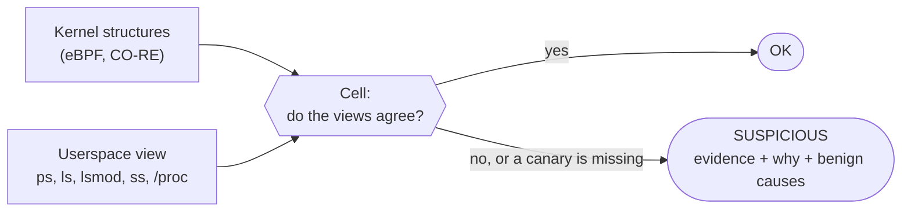

<div align="center">

<pre>
███████╗██╗   ██╗ ██████╗  █████╗ ██████╗ ██████╗ ███████╗
╚══███╔╝╚██╗ ██╔╝██╔════╝ ██╔══██╗██╔══██╗██╔══██╗██╔════╝
  ███╔╝  ╚████╔╝ ██║  ███╗███████║██████╔╝██║  ██║█████╗  
 ███╔╝    ╚██╔╝  ██║   ██║██╔══██║██╔══██╗██║  ██║██╔══╝  
███████╗   ██║   ╚██████╔╝██║  ██║██║  ██║██████╔╝███████╗
╚══════╝   ╚═╝    ╚═════╝ ╚═╝  ╚═╝╚═╝  ╚═╝╚═════╝ ╚══════╝
</pre>

**Linux rootkit detection using eBPF CO-RE**

</div>

Zygarde is a forensic triage tool for Linux. It compares **what the kernel actually holds**, read with eBPF, against **what userspace is shown** through the usual syscalls and files. A rootkit that hides a process, file, module, hook, socket or eBPF program leaves a gap between the two, and Zygarde reports it with the evidence, why it matters, and what innocent cause to rule out first.

- **One static binary**, no runtime dependencies, x86_64 and arm64. CO-RE and BTF relocate the same eBPF bytecode for the running kernel. Built on [cilium/ebpf](https://github.com/cilium/ebpf).
- **13 detection modules ("Cells")**: hidden processes, files, modules, sockets and eBPF programs; syscall, ftrace, kprobe, inline and netfilter hooks; swapped kernel function pointers; `LD_PRELOAD`-style userspace hooks.
- **Hard to blind.** It plants canaries it knows must be visible, runs its checks in a supervised worker, and does not use libc.



> **Note (order of volatility):** Zygarde is experimental, aimed at exploring what eBPF can do for DFIR. Loading eBPF programs and probing kernel structures leaves live-kernel traces (BPF/PID allocations, audit events), although files and directories are opened with `O_NOATIME` and temporary mounts live in private mount namespaces. If you already suspect a specific high-value host, capture RAM first (AVML/LiME) and analyse it offline (Volatility 3). Use Zygarde first for rapid fleet-wide triage.

## Quick start

Needs Linux 5.8+ with BTF and root (`CAP_BPF`/`CAP_SYS_ADMIN`).

```bash
make build                                       # ./zygarde (Go only, no clang needed)
sudo ./zygarde                                   # run all checks, human-readable report
sudo ./zygarde -v                                # also explain each check, show observations and canaries
sudo ./zygarde --cells hidden_process,hidden_file
sudo ./zygarde -o report.json --preserve-dir ./evidence
./zygarde --list                                 # the checks
```

No Linux machine? `make docker-run` runs it in a privileged container on the Docker host's kernel (works from Windows and macOS).

**Exit code:** `0` nothing found, `1` a check could not complete, `2` something is SUSPICIOUS.

**Statuses:** `OK` (nothing found), `SUSPICIOUS` (evidence of tampering), `SKIPPED` (does not apply to this kernel, reason given), `ERROR` (could not complete). A clean verdict only covers what ran; the *Coverage* section of the report says what did not.

## What it checks

| Cell | Kernel view | Userspace view / rule |
|------|-------------|-----------------------|
| `ebpf_integrity` | canary program and map loaded by Zygarde | `bpf()` enumeration |
| `altered_syscall_table` | `sys_call_table` entries | `/proc/kallsyms` |
| `hook_inventory` | ftrace `enabled_functions`, kprobes | owner: kernel, module, BPF, livepatch |
| `inline_hook` | first bytes of syscall, VFS and `/proc` functions | what the kernel writes there |
| `kernel_pointers` | `file_operations`, `seq_operations`, `proc_ops` behind `/proc`, `/sys` | pointer owner |
| `hidden_kernel_module` | `/sys/module` kobjects; boot persistence | `/proc/modules` |
| `kernel_taint` | kernel taint flags | per-module taint |
| `hidden_process` | BPF task iterator, `init_task` walk, `sched_switch` | `/proc` listings |
| `hidden_file` | what the filesystem produced (`filldir64`) | what `getdents64` returned |
| `hidden_ebpf_program` | BPF program iterator, attachments, holders | `BPF_PROG_GET_NEXT_ID`, `/sys/fs/bpf` |
| `hidden_socket` | BPF socket iterators, `sock_diag`, socket FDs | `/proc/net/*` |
| `netfilter_hooks` | `nf_hook_entries` of every namespace | owner of each hook |
| `userspace_hooks` | - | `ld.so.preload`, `LD_PRELOAD`, injected and trojaned libraries |

Per-Cell details, requirements and SUSPICIOUS conditions: [docs/cells.md](docs/cells.md).

## Build and test

```bash
make build         # ./zygarde for this machine
make dist          # dist/zygarde-linux-{amd64,arm64}
make test          # unit tests (make docker-test inside the toolchain image, on any OS)
make generate      # recompile the eBPF programs after editing a .bpf.c (needs clang; or make docker-generate)

make vm-upstream   # boot upstream kernels 4.19 to 7.2 in QEMU/KVM and run Zygarde in each, about 1 minute
make vm-distro     # same on distribution cloud images (Ubuntu, Debian, Rocky, Fedora, Amazon Linux, openSUSE)
make vm-report     # Markdown matrix of the results
```

On a clean VM every Cell must be OK or SKIPPED with all canaries seen. Fixture targets (`*-fixtures`) plant harmless stand-ins to check that detections still fire. See [docs/testing.md](docs/testing.md).

## Validated against real samples

Besides the clean-kernel matrix and planted fixtures, Zygarde has been run against real Linux rootkit and backdoor samples on disposable VMs (Ubuntu 7.0, AlmaLinux 10 with SELinux, Debian 11, and emulated arm64), each compared with a clean baseline scan of the same VM.

| Detected | Through |
|----------|---------|
| BPFDoor (several builds, including ones with 0 detections on VirusTotal) | `hidden_process`, `hidden_socket` (packet-sniffer rule) |
| Prism | `hidden_socket` (raw ICMP socket) |
| HiddenWasp | `hidden_file` |
| Ebury (trojaned `libkeyutils`) | `userspace_hooks` (package checksum verification) |
| LinkPro (preload module), Auto-color, perfctl | `userspace_hooks` |
| Symbiote, Azazel, Jynx, OrBit, Facefish, libprocesshider and other process hiders | `userspace_hooks` |
| Winnti (process named `[scsi_eh]`), XMRig (`.kworker_sys`), Mirai/JoyBot-style bot (memfd, `kworker`) | `hidden_process` |
| Diamorphine (module failed to load) | `kernel_taint` |

Not detected: persistence-only implants that hide nothing until a later stage arrives (a Go agent posing as `systemd-netd`), and dormant or silent samples (Skidmap, Kaiji, XorDDoS, a dormant Prism variant). Prebuilt kernel-module and libbpf 0.x eBPF rootkits (Boopkit, TripleCross, ebpfkit, most LKMs) do not load on current kernels, so the kernel-side Cells were exercised through the fixtures instead.

## Documentation

| | |
|---|---|
| [Getting started](docs/getting-started.md) | requirements, building, first run, containers |
| [Usage and reports](docs/usage.md) | flags, exit codes, reading findings, JSON schema |
| [Cell reference](docs/cells.md) | what each check does, and when it reports SUSPICIOUS |
| [Architecture](docs/architecture.md) | process model, Cell contract, eBPF layer, tamper resistance |
| [Compatibility](docs/compatibility.md) | kernels, lockdown, distributions verified |
| [Development](docs/development.md) | layout, regenerating eBPF objects, adding a Cell |
| [Testing](docs/testing.md) | unit tests, kernel matrix, fixtures, CI |

## References

- [cilium/ebpf](https://github.com/cilium/ebpf), [BPF CO-RE](https://nakryiko.com/posts/bpf-portability-and-co-re/), [BPF iterators](https://docs.kernel.org/bpf/bpf_iterators.html)
- [x86/syscall: Don't force use of indirect calls for system calls](https://git.kernel.org/torvalds/c/1e3ad78334a6)
- [libbpf/vmlinux.h](https://github.com/libbpf/vmlinux.h) (source of `bpf/include/arm64/vmlinux.h`)
- Rootkit analyses behind the checks: Synacktiv, [LinkPro](https://www.synacktiv.com/publications/linkpro-analyse-dun-rootkit-ebpf); Sandfly Security, [Linux Scales eBPF Rootkit](https://sandflysecurity.com/blog/linux-scales-ebpf-rootkit-detection-and-analysis); ExaTrack, [Mélofée](https://exatrack.com/publications/melofee.html); Elastic Security Labs, [Linux Rootkits 2: Caught in the Act](https://www.elastic.co/security-labs/threat-command/linux-rootkits-2-caught-in-the-act)
- Malware and rootkit families the checks were designed against or tested on (see [Validated against real samples](#validated-against-real-samples)):
  - **eBPF:** LinkPro, Scales, Boopkit, TripleCross, ebpfkit
  - **Kernel modules and function hooking:** Reptile, Mélofée (khook), Diamorphine, adore-ng, Snapekit, VoidLink, Singularity, Syslogk, FontOnLake
  - **Backdoors waiting for a trigger packet:** BPFDoor (Red Menshen), Prism
  - **`LD_PRELOAD` and library trojans:** Azazel, Jynx, OrBit, Symbiote, Facefish, HiddenWasp, Auto-color, perfctl, Ebury, libprocesshider
  - **Disguised processes and loaders:** Winnti, XMRig miners, Mirai/JoyBot-style bots, Skidmap, Kaiji, XorDDoS

## License

Dual BSD/GPL; see [LICENSE](LICENSE). The vendored libbpf headers are LGPL-2.1 OR BSD-2-Clause.
