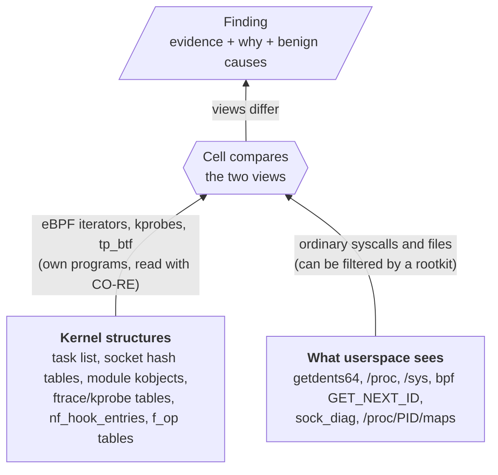
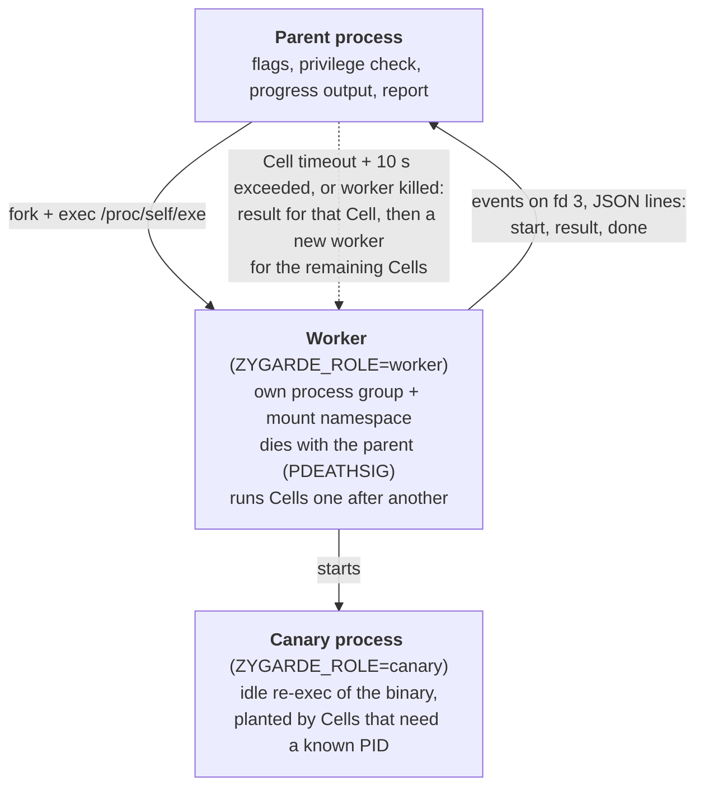

# Architecture

## The idea

A rootkit hides by filtering what userspace is shown: it hooks `getdents64`, rewrites `/proc/net/tcp` output, unlinks itself from the module list. The kernel still holds the real data. Zygarde reads the same thing through two independent paths and reports the gap:



Some Cells have no second view and instead check a property that a rootkit cannot hide without leaving a mark: every function pointer in a kernel operations table must point to the kernel or to a visible module; every ftrace redirection must belong to livepatch; the first bytes of a kernel function must be what the kernel wrote there.

Because the rootkit may also attack the scanner, the design adds [canaries, a supervised worker and no-libc execution](#resisting-tampering).

## Process model



- The binary re-executes itself in different roles, selected by the `ZYGARDE_ROLE` environment variable (`worker` or `canary`). A role is honoured only when `ZYGARDE_PARENT` matches the real parent PID, so a stale variable (for instance kept by `sudo -E`) cannot turn the operator's own command into a canary.
- The worker sends one JSON event per line over fd 3: `start` (Cell begins), `result` (full `core.Result`), `done`. Its stdout is redirected to stderr so JSON mode stays clean.
- The parent arms a timer for each Cell: the Cell's own `Timeout()` plus 10 seconds.
- If the worker dies or hangs mid-Cell, the parent turns that into a result for that Cell, cleans up leftover canaries, and starts a **new worker for the remaining Cells**. One killed Cell never ends the scan.
- `SIGKILL` of a worker is reported as SUSPICIOUS (something on the system killed the scanner), unless the kernel's OOM-kill counter (`/proc/vmstat`, cgroup `memory.events`) moved during the Cell, in which case it is an ERROR. A worker that does not exit within 5 seconds of `SIGKILL` (stuck in uninterruptible I/O) is abandoned with an ERROR.
- Where `CLONE_NEWNS` is refused (a container without `CAP_SYS_ADMIN`), the worker falls back to a plain child process.
- `--no-isolation` skips all of this and calls the Cells in-process.

Code: `internal/supervisor/`.

## The Cell contract

Defined in `internal/core/cell.go`:

```go
type Cell interface {
    ID() string                 // "hidden_process"
    Name() string               // human-readable
    Description() string
    Timeout() time.Duration
    Supported(env *Env) error   // nil, or core.Skip("reason")
    Run(ctx context.Context, env *Env, rec *Recorder) error
}
```

`core.RunCell` wraps each Cell:

1. `Supported(env)`: a `SkipError` (or `ebpf.ErrNotSupported`) makes the result SKIPPED.
2. `Run` with a context bounded by `Timeout()`. A panic is recovered and reported as ERROR.
3. The Recorder's contents are copied into the `Result`. Any finding raises the status to SUSPICIOUS; every canary with `Observed == false` adds an automatic finding ("Canary X was not visible in Y") and also raises it.
4. A returned error is classified (`core.Classify`):
   - skip or "not supported": SKIPPED
   - a `BPFError` that is `EPERM`/`EACCES` while `Env.BPFExpected()` says eBPF should work: **SUSPICIOUS**, with a finding that records why it was expected to work
   - anything else: ERROR

The Recorder (`internal/core/cell.go`) is how a Cell speaks:

| Method | Use |
|--------|-----|
| `Suspicious(Finding)` | evidence of tampering. Fill `Details` (evidence), `Why`, `Benign` |
| `Observe(desc, details)` | context, not suspicious (legitimate hooks, inventories). Capped at 2000 per Cell |
| `Canary(name, view, observed)` | a planted object and whether a given view showed it |
| `Limit(fmt, ...)` | part of the Cell that could not run here, shown under Coverage |
| `Footprint(kind, value)` | transient object Zygarde created, for deconfliction |
| `Message(fmt, ...)` | one-line summary |

Order of execution is the order in `allCells` (`cmd/zygarde/main.go`). `ebpf_integrity` is first because later Cells depend on `bpf()` working.

## Environment probing

`core.ProbeEnv` runs once per worker and collects facts **without using `bpf()`**, so they remain meaningful if `bpf()` is tampered with: architecture, kernel release, boot time, effective UID, capabilities and seccomp mode from `/proc/self/status`, user-namespace status, LSM label and confinement, lockdown mode, kernel BTF (or `--btf`), and whether `RLIMIT_MEMLOCK` could be lifted (needed before Linux 5.11). Cells use helpers such as `RequireBTFType("bpf_iter_task", "...")` to skip on missing features, and `Kallsyms()` for the lazily parsed `/proc/kallsyms`.

## eBPF layer

Each eBPF Cell has a `<name>.bpf.c` next to its Go code. `bpf2go` (cilium/ebpf) compiles it for amd64 and arm64 into `*_bpfel.o` plus a Go binding, both committed, and the object is embedded in the binary. At runtime:

1. `bpfutil.Load` loads the objects with CO-RE relocations resolved against the running kernel's BTF (or the file given with `--btf`).
2. `bpfutil.SetTarget` writes the const globals `pidns_dev`, `pidns_ino` and `target_tgid`. The shared helper `is_target()` (`bpf/include/zygarde.h`) then lets a program react only to Zygarde's own process, using `bpf_get_ns_current_pid_tgid()` where available so it works inside containers.
3. The Cell attaches iterators (`iter/task`, `iter/task_file`, `iter/tcp`, `iter/udp`, `iter/bpf_prog`...), kprobes (`filldir64`), raw tracepoints (`tp_btf`, which need no tracefs), fentry or netfilter links, and reads the output or maps.
4. The Cell releases everything before returning.

Supporting packages:

| Package | Role |
|---------|------|
| `internal/fdowner` | BPF task-file iterator reporting which processes hold BPF programs, links and sockets, from every task's file table, including processes hidden from `/proc` |
| `internal/kattr` | address attribution: kernel image, visible module, BPF program, trampoline, or unknown |
| `internal/kernel` | `/proc/kallsyms` (and the kernel image range), lockdown, tracefs, `/proc/self/status` |
| `internal/netlink` | minimal netlink dumps: `sock_diag`, links, qdiscs, tc filters |
| `internal/rpmdb` | read-only SQLite reader for the rpm database, including its write-ahead log |
| `internal/fsutil` | safe opens of user-controlled paths, `openat2` inside a process's root, artifact preservation |
| `internal/report` | host facts, scanner footprint, verdict |

### Address attribution

Used by `hook_inventory`, `kernel_pointers`, `inline_hook` and `netfilter_hooks` to answer "who owns this code?":

1. Inside the kernel image (`_stext` to `_end` from `/proc/kallsyms`, sanity-checked): kernel.
2. Otherwise the `/proc/vmallocinfo` allocation containing the address, owned by the modules, BPF programs or trampolines whose symbols (`[module]`, `[bpf]`, `[__builtin__ftrace]`, `[__builtin__kprobes]`) or `/sys/module/*/sections` fall inside it.
3. Code in an allocation that nothing visible owns runs from a **hidden module** (or from injected memory): SUSPICIOUS.

Without `/proc/vmallocinfo`, attribution falls back to distances from module symbols and uncertain results become observations. Allocations shared by several modules (execmem caches, Linux 6.14+) go to the nearest module below the address. If `/proc/kallsyms` hides addresses (`kptr_restrict`), the dependent Cells report SKIPPED.

## Resisting tampering

| Mechanism | What it defends against |
|-----------|-------------------------|
| **Canaries** (`internal/canary` and per-Cell objects) | Filtering of a view. Cells plant randomised objects they know exist (an idle child process, an in-memory file, their own BPF programs and maps, sockets, a kprobe, a netfilter link, `bpf()` calls) and look for them in every view. A miss is SUSPICIOUS. Names are random (`canary.ProgName`, `canary.Token`) and never contain "zygarde", so they cannot be allowlisted |
| **`comm` baiting** | Rootkits that only hide from certain process names. Userspace views are queried under standard tool names (`ps`, `ls`, `bpftool`, `ss`, `netstat`) |
| **Blocked eBPF is a finding** | A rootkit that makes `bpf()` fail. See `Classify` above |
| **Supervised worker** | A rootkit that kills or freezes the scanner. See [Process model](#process-model) |
| **Careful opens** | Symlink and FIFO tricks planted for a root scanner: paths other users control are opened with `O_NOATIME`, `O_NOFOLLOW`, `O_NONBLOCK`, regular files only, up to 4 MiB; system configuration follows only root-owned symlinks in root-only directories. A file that cannot be parsed completely (too large, padded) is reported |
| **Address sanity** | A poisoned `/proc/kallsyms`. Addresses are read from kernel memory only if inside the kernel image; a watched symbol outside it is SUSPICIOUS; the tables of `/proc`, `/proc/net/tcp`, `/proc/modules` and `/proc/kallsyms` must be where `kallsyms` says |
| **No libc** | `LD_PRELOAD`, `LD_AUDIT` and libc-hooking rootkits. The binary is static Go and calls the kernel directly. `userspace_hooks` reports those hooks, since they still fool every other tool |
| **Minimal footprint** | Files and directories opened with `O_NOATIME`; private mount namespaces for anything mounted; everything created is listed in `scanner_footprint` |

## Limits of the approach

- The kernel view itself is data a sufficiently capable kernel rootkit could rewrite. Zygarde raises the cost (canaries, independent paths, pointer and prologue checks) but is not a replacement for memory forensics.
- Detections are tied to what the kernel exposes: Cells skip (and say so) when BTF types, iterators or symbols are missing, and under lockdown `confidentiality` most memory-reading Cells cannot run. See [Compatibility](compatibility.md).
- eBPF itself leaves live-kernel traces; capture memory first on a host you already know is compromised.
