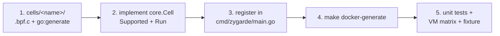

# Development

## Layout

```
cmd/zygarde/            CLI, text output, supervisor wiring
cells/<name>/           one package per Cell: <name>.bpf.c + generated bindings + Go logic
internal/core/          Cell interface, Recorder, Result/Status, Env probing, error classification
internal/supervisor/    parent/worker process split and protocol
internal/canary/        canary processes, files, random names
internal/bpfutil/       loading, iterators, target filtering, enumeration helpers
internal/fdowner/       BPF task-file iterator: who holds BPF objects and sockets
internal/kattr/         kernel address attribution
internal/kernel/        kallsyms, lockdown, tracefs, /proc/self/status
internal/fsutil/        safe opens, O_NOATIME, openat2 in a process's root, artifact preservation
internal/netlink/       minimal netlink dumps (sock_diag, links, qdiscs, tc filters)
internal/rpmdb/         read-only SQLite reader for the rpm database
internal/report/        host facts, scanner footprint, verdict
bpf/include/            vendored libbpf headers, per-arch vmlinux.h, zygarde.h
test/vm/                kernel matrix harness
test/bpfsame/           keeps committed BPF objects stable across build hosts
build/                  Dockerfiles: toolchain, VM test harness
```

How the pieces fit together is in [Architecture](architecture.md).

## Building

The generated eBPF objects and Go bindings (`cells/*/*_bpfel.{go,o}`, `internal/fdowner/*_bpfel.{go,o}`) are committed, so a plain Go build needs no clang.

| Target | Does |
|--------|------|
| `make build` | `./zygarde` for this machine (`CGO_ENABLED=0`, `-trimpath`, stripped) |
| `make dist` | `dist/zygarde-linux-amd64` and `dist/zygarde-linux-arm64` |
| `make test` / `make vet` / `make fmt` | `go test ./...`, `go vet ./...`, `go fmt ./...` |
| `make generate` | compile every `.bpf.c` with clang and regenerate bindings (needs clang and llvm) |
| `make docker-<target>` | the same in the pinned toolchain image (`build/Dockerfile`: Go 1.25 + clang 19), from Linux, macOS or Windows |
| `make docker-run ARGS="..."` | run the built binary in a privileged container |

Requires Go 1.25 (see `go.mod`). `bpf2go` is a Go tool dependency, run through `go tool bpf2go`.

### Binary size

Release binaries are static (`CGO_ENABLED=0`), built with `-trimpath` and linked with `-s -w` (no symbol table, no DWARF): about 6.5 MB on amd64 and 6.2 MB on arm64. About 10% of that is the embedded BPF objects, mostly the BTF that CO-RE relocation needs. Keep heavy standard-library packages out of the import graph: package `net`, for instance, would add about 130 KB, so the socket Cell opens its canary sockets with raw syscalls instead.
### Regenerating BPF objects

After changing a `.bpf.c` file or `bpf/include/`:

```bash
make docker-generate   # preferred: pinned clang, same as CI
```

CI regenerates in that image and fails if `cells/` or `internal/` differ from what is committed, so commit the regenerated `*_bpfel.{go,o}`. clang numbers some BTF forward declarations differently depending on the build host CPU; after `go generate`, `make generate` runs `test/bpfsame`, which restores the committed `.o` when the BTF forward-declaration numbering is the only difference. Real differences stay visible in `git diff`.

On Windows from Git Bash, set `MSYS_NO_PATHCONV=1` when invoking `docker run` by hand with `/src` style paths.

## Adding a Cell



1. **Scaffold.** Create `cells/<name>/` with a `.bpf.c` file (start it with `//go:build ignore`) and a `//go:generate go tool bpf2go ...` line, copying an existing Cell. Include `zygarde.h` for `is_target()`.
2. **Implement `core.Cell`:**
   - `ID()`, `Name()`, `Description()`, `Timeout()`.
   - `Supported(env)` returns `core.Skip(...)` when the kernel lacks something. Prefer `env.RequireBTFType`; use `env.RequireUserMemoryReads()` if you read user memory.
   - `Run(ctx, env, rec)` records through `rec`:
     - `rec.Suspicious(core.Finding{...})` with evidence in `Details`, plus `Why` (why it indicates tampering) and `Benign` (what to rule out first);
     - `rec.Canary` for objects Zygarde planted;
     - `rec.Limit` for any part that could not run here;
     - `rec.Observe` for context; `rec.Message` for the one-line summary; `rec.Footprint` for artifacts you create.
   - Wrap failing `bpf()` operations with `core.WrapBPF` so denials are classified correctly.
   - Release every kernel resource (programs, maps, links, canaries) before returning.
3. **Load only your own objects** with `bpfutil.Load`, and filter on Zygarde's own process with `is_target()` and `bpfutil.SetTarget`. Read files under user-controlled paths with `internal/fsutil`. Only pass BPF kernel addresses checked against `Kallsyms.Image()`.
4. **Register** the Cell in `allCells` in `cmd/zygarde/main.go` (order matters: `ebpf_integrity` stays first), then run `make docker-generate`.
5. **Test it:** unit tests for parsing and decision logic; run the [VM matrix](testing.md) to confirm OK/SKIPPED on clean kernels; add a fixture and a `fixtures.expect` line if a detection can be planted safely.
6. **Document it:** add a section to [Cell reference](cells.md) and a row to the table in the README.

### Conventions

- A Cell that cannot run is SKIPPED with a reason, never ERROR. Reserve ERROR for something that should have worked and did not.
- Every finding should say *why* it indicates tampering and which *benign causes* to rule out: the report shows both.
- Prefer two independent views to a single signature. If a Cell has only one view, state the invariant it enforces.
- Plant a canary for each view you compare, with random names.
- Do not read files with `os.ReadFile` on user-controlled paths: use `fsutil` (no symlink follow, `O_NOATIME`, `O_NONBLOCK`, size cap).
- Keep BPF programs verifier-friendly on old kernels: unroll bounded loops (`#pragma unroll`), avoid features missing before 5.10, and gate newer ones with `bpf_core_*_exists` or a BTF-type check in `Supported`.

## Release

`version` in `cmd/zygarde/main.go` (overridden by the Makefile with `git describe`) is reported by `--version` and stored in every report. CI builds `dist/` for both architectures and uploads them as an artifact.
