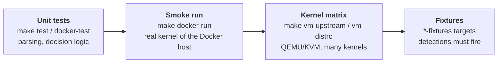
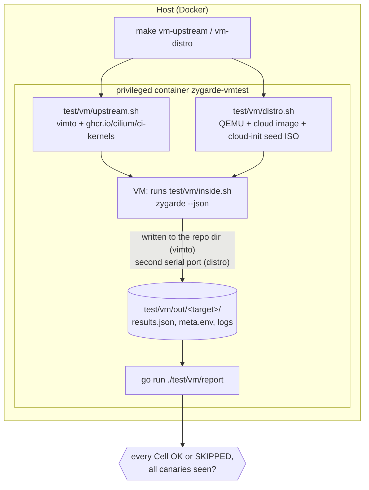

# Testing

There are three levels, from fast to realistic.



## 1. Unit tests

```bash
make test           # go test ./...   (needs Linux for most packages)
make vet
make docker-test    # go vet + go test inside the toolchain image; works on Windows and macOS
```

They cover parsing and decision logic in each Cell package (ftrace and kprobe lists, `/proc/net` and sniffer filters, kernel module and boot persistence, masquerade detection, taint, attach points, instruction decoding), plus `internal/core` (error classification), `internal/supervisor`, `internal/kattr`, `internal/rpmdb`, `internal/fsutil` and report rendering. They do not load eBPF programs.

`cells/bpfprog/helpers_vm_test.go` loads a real program and so is behind the `vmtest` build tag. Run it as root inside a test VM: `go test -tags vmtest ./cells/bpfprog/`.

## 2. Smoke run on a real kernel

```bash
make docker-run ARGS="-v"
```

Runs the freshly built binary in a privileged Debian container on the Docker host's kernel. Good for checking that nothing crashes and that the output reads well. The kernel is whatever your Docker host runs, so it exercises one kernel only.

## 3. Kernel matrix

Compatibility is tested by booting real kernels with QEMU/KVM inside a privileged container (`build/vmtest.Dockerfile`) and running Zygarde in each. On a **clean** VM every Cell must be OK or SKIPPED with every canary observed.

```bash
make vm-upstream                              # upstream LTS kernels, about 1 minute
make vm-distro                                # cloud images listed in test/vm/distros.txt
make vm-distro DISTROS="rocky-8 debian-12" JOBS=4
make vm-upstream KERNELS="6.1.188 6.6.157"
make vm-report                                # Markdown matrix of test/vm/out
```

Requirements: Docker, and `/dev/kvm` available inside privileged containers. On Docker Desktop with WSL2, start any WSL distribution first so the `kvm` module loads. The scripts check for `/dev/kvm` and say so if it is missing.



### Targets

- **Upstream** (`test/vm/upstream.sh`): 4.19.322, 5.4.296, 5.10.270, 5.15.221, 6.1.188, 6.6.157, 6.12.111, 6.18.53, 7.2.7 from `ghcr.io/cilium/ci-kernels`, booted with `vimto` with 1 GB and 2 CPUs. The old ones (4.19, 5.4) check that Zygarde degrades to SKIPPED; 5.10 predates the `x64_sys_call()` change so the syscall-table Cell runs for real.
- **Distributions** (`test/vm/distro.sh`): official cloud images from `test/vm/distros.txt` (name, URL, optional lockdown mode, arch, fixtures flag). cloud-init runs `inside.sh` from a seed ISO and results come back over a second serial console (virtio console on arm64), so no SSH or network setup is needed. Images are cached in the `zygarde-vmimages` Docker volume. Dated images pin pre-April-2024 kernels so the syscall-table Cell runs on a distribution kernel.
- **Lockdown** targets (`-lockdown`, `-integrity`) raise kernel lockdown through `/sys/kernel/security/lockdown` before running, to test lockdown handling. It cannot be lowered without a reboot.
- **arm64** images are emulated with QEMU TCG: several minutes per VM. The environment variable `VM_TIMEOUT` (default 900 s, tripled for emulated VMs) bounds each VM; `JOBS` (default 6) sets parallelism.

### What the report checks

`go run ./test/vm/report test/vm/out` prints a Markdown matrix and exits non-zero if any target has an ERROR, a SUSPICIOUS result or a missed canary, or failed to boot. Each target directory holds `results.json` (the Zygarde JSON report), `meta.env` (kernel, distro, BTF, lockdown, exit code, boot errors) and logs.

### CI

`.github/workflows/ci.yml`:

1. **build**: regenerates the BPF bindings in the pinned toolchain image and fails on any diff; `go vet`; `go test`; `make dist`; a smoke run on the runner's own kernel (exit code 1 fails the job, 0 and 2 are valid); uploads `dist/`.
2. **kernels**: installs QEMU and `vimto`, runs `test/vm/upstream.sh` on every upstream kernel, prints the matrix to the job summary and the log.

The runner's root filesystem is used as the VM's root, so filesystem-reading checks see the runner's configuration under a foreign kernel; a local `make vm-upstream` does not reproduce exactly that.

## Fixtures: detections must fire

A clean-VM matrix proves there are no false positives. Fixture targets prove the opposite: that the detections still work. Targets marked `fixtures` in `distros.txt` run `test/vm/fixtures.sh` before the scan, which plants harmless stand-ins:

| Stand-in | Cell expected to report it |
|----------|----------------------------|
| `/etc/ld.so.preload` naming an existing library | `userspace_hooks` |
| a `sudo` copy in `/usr/bin/.local` (Scales) | `hidden_file` |
| `insmod /etc/intel_audio/intel_audio.ko` in `/etc/rc.modules` (Mélofée) | `hidden_kernel_module` |
| a `modprobe.d` `install` directive running a command | `hidden_kernel_module` |
| a root process running from a binary deleted from `/tmp` | `hidden_process` |
| a child process disguised as `[kworker/0:7]` | `hidden_process` |
| an empty directory bind-mounted over a process's `/proc/<pid>` (SELinux is switched off for the mount) | `hidden_process` |
| `test/vm/fixture`: do-nothing programs on `sys_enter_getdents64`, a kprobe, XDP and tc egress on `lo` | `hidden_ebpf_program` (observations, with `held_by=zyg-fixture`) |

The report then checks each target against `test/vm/fixtures.expect` (`cell|finding or observation|substring[|detail=substring]`) instead of requiring a clean result. A fixture target passes when every line matches, no Cell errors and no canary is missed. Fixture VMs are throwaway: the script modifies `/etc`, `/usr/bin` and `/tmp`.

To run only the fixture check without VMs, in a privileged container: build zygarde and `go build ./test/vm/fixture`, mount bpffs, then `FIXTURE=<path> sh test/vm/inside.sh ./zygarde test/vm/out/<name>` and `go run ./test/vm/report test/vm/out`.

### Adding a distribution or a fixture

- Distribution: add a line to `test/vm/distros.txt`: `name|image URL|lockdown|arch|fixtures`. Run `make vm-distro DISTROS=<name>`.
- Fixture: plant it in `test/vm/fixtures.sh` (or in `test/vm/fixture/main.go` for BPF-based ones) and add the expected line to `test/vm/fixtures.expect`.

## Testing against real samples

Fixtures are stand-ins, not real malware. To validate against real rootkit samples, use disposable VMs that you can reset to a clean state, never a host you care about: run the sample, wait for it to establish itself, run Zygarde, and compare against a clean baseline scan of the same VM. Prebuilt kernel modules and eBPF rootkits often fail to load on recent kernels (module vermagic, old libbpf, verifier), so many samples do nothing; check that the sample actually installed before concluding anything. Do not unpack or run samples on your workstation.
